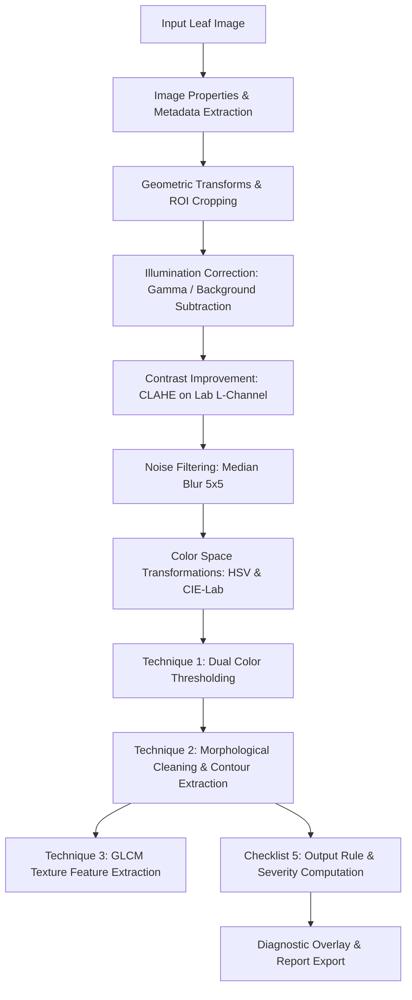

# AgriVision: Plant Leaf Disease Detection and Severity Grading Pipeline

---

## 1. Problem Statement

> **Final Problem Statement:**  
> *"Automated detection, localization, and severity grading of foliar diseases in tropical fruit trees (Mango, Lime, and Jackfruit) using traditional digital image processing and morphological contour analysis."*

### System Outputs:
1. **Segmented Leaf Canopy Mask** and **Extracted Disease Lesion Mask**.
2. **Infection Severity Index (%)**: Computed precisely as:
   $$\text{Severity Index (\%)} = \left( \frac{\text{Total Lesion Area (pixels)}}{\text{Total Leaf Canopy Area (pixels)}} \right) \times 100$$
3. **Health Status Classification & Grading**:
   - **Grade 0 (Healthy / Negligible)**: $\text{Severity} < 2\%$
   - **Grade 1 (Mild Infection)**: $2\% \le \text{Severity} \le 15\%$
   - **Grade 2 (Severe Infestation)**: $\text{Severity} > 15\%$
4. **Bounding Box & Contour Overlay** localizing necrotic lesion spots on the input leaf.

---

## 2. Dataset Specification

| Metric | Project Value | Checklist 50% Requirement | Status |
| :--- | :--- | :--- | :--- |
| **Total Images** | **30** | At least 30 images | ✅ Meets Requirement |
| **Captured / Created Images** | **18** | At least 10 images | ✅ Exceeds (≥10) |
| **Unseen Test Evaluation Set** | **10** | At least 10 images set aside | ✅ Meets (≥10) |
| **Organized Folders** | `dataset/<Fruit_Domain>/<Class>/` | Clearly named folders | ✅ Complete |
| **Metadata Record** | `dataset/dataset_metadata.csv` | Record of source, res, format, purpose | ✅ Complete |

### Dataset Directory Structure:
```text
dataset/
├── dataset_metadata.csv
├── Jack Fruit/
│   ├── diseased/       (4 images: j_d1_c.jpg, j_d2_c.jpg, j_d3.jpg, j_d4.jpg)
│   ├── healthy/        (4 images: j_h1_c.jpg, j_h2_c.jpg, j_h3.jpg, j_h4.jpg)
│   └── test/           (4 images: j_t1_c.jpg, j_t2_c.jpg, j_t3.jpg, j_t4.jpg)
├── Lime/
│   ├── diseased/       (2 images: l_d1_c.jpg, l_d2_c.jpg)
│   ├── healthy/        (2 images: l_h1_c.jpg, l_h2_c.jpg)
│   └── test/           (2 images: l_t1_c.jpg, l_t2_c.jpg)
└── Mango/
    ├── diseased/       (4 images: m_d1_c.jpg, m_d2_c.jpg, m_d3.jpg, m_d4.jpg)
    ├── healthy/        (4 images: m_h1_c.jpg, m_h2_c.jpg, m_h3.jpg, m_h4.jpg)
    └── test/           (4 images: m_t1_c.jpg, m_t2_c.jpg, m_t3.jpg, m_t4.jpg)
```

---

## 3. Core Processing Pipeline Architecture

The entire pipeline runs as **one integrated application** (`app.py`) built with OpenCV, NumPy, Scikit-Image, and Streamlit.



### Key Pipeline Components:
1. **File Loading & Validation**: Single image upload & batch folder scanning with `try/catch` error protection against corrupt files.
2. **Metadata Inspector**: Real-time extraction of dimensions ($W \times H$), channels, bit-depth, total pixels, memory footprint, and file size.
3. **Color Spaces**:
   - **Grayscale**: Intensity analysis.
   - **HSV**: Hue/Saturation segmentation for green foliage and brown/yellow necrotic spots.
   - **CIE-Lab**: Decoupling luminance ($L^*$) from chromaticity ($a^*, b^*$).
   - **YCrCb**: Luminance/Chrominance representation.
   - **Binary**: Otsu and Adaptive Gaussian thresholding.
4. **Contrast Enhancement & Illumination Correction**:
   - **Contrast Enhancement**: CLAHE (Contrast-Limited Adaptive Histogram Equalization) on $L$-channel.
   - **Illumination Correction**: Gamma correction ($\gamma = 1.2$) and Background Illumination Subtraction.
5. **Noise Filtering**:
   - Compares **Gaussian Blur**, **Median Filter**, and **Bilateral Filter**.
   - Selected: **Median Filter** ($5 \times 5$).
6. **Geometric Transformations**:
   - Rotation ($90^\circ, 180^\circ, 270^\circ$, arbitrary angle).
   - Flip (Horizontal, Vertical, Both).
   - Scaling / Resize.
   - Region of Interest (ROI) Cropping with real-time sub-region intensity statistics.

---

## 4. Domain Analysis Techniques (Status: 50% Stage)

We have committed to **four techniques** for final submission:

| # | Technique | Status at 50% Review | Role in Pipeline |
| :- | :--- | :--- | :--- |
| **1** | **Color Space Segmentation** (HSV + Lab thresholding) | **Working & Integrated** | Separates leaf canopy from background and isolates necrotic disease spots. |
| **2** | **Morphological Operations & Contour Analysis** | **Working & Integrated** | Eliminates noise specks, fills holes, detects individual lesions, and measures total diseased area. |
| **3** | **GLCM Texture Feature Extraction** | **Feature Extraction Ready** | Computes Contrast, Dissimilarity, Homogeneity, Energy, and Correlation. |
| **4** | **Rule-Based Decision Logic** | **Working & Integrated** | Evaluates Infection Severity Index into Grade 0/1/2 diagnosis. |

---

## 5. Output Rule

The exact mathematical formulation implemented in code is:

$$\text{Severity Index (\%)} = \left( \frac{\sum_{i=1}^{N} \text{Area}(\text{Lesion Contour}_i)}{\text{CountNonZero}(\text{Leaf Canopy Mask})} \right) \times 100$$

### Decision Thresholds:
$$\text{Status} = \begin{cases} 
\text{Healthy / Negligible}, & \text{if } \text{Severity} < 2.0\% \\
\text{Mild Infection}, & \text{if } 2.0\% \le \text{Severity} \le 15.0\% \\
\text{Severe Infestation}, & \text{if } \text{Severity} > 15.0\%
\end{cases}$$

---

## 6. Evaluation Plan

1. **Evaluation Measure 1: IoU (Intersection over Union)**
   - Measures lesion segmentation overlap against annotated ground truth binary masks:
     $$\text{IoU} = \frac{|M_{\text{pred}} \cap M_{\text{GT}}|}{|M_{\text{pred}} \cup M_{\text{GT}}|}$$
2. **Evaluation Measure 2: Classification F1-Score & Count Error**
   - Assesses 3-class disease severity grading accuracy and absolute spot count error:
     $$\text{Count Error} = |N_{\text{detected}} - N_{\text{ground\_truth}}|$$
3. **Ground Truth Status**: 13 unseen images set aside in `dataset/*/test/` ready for manual polygon mask annotation.

---

## 7. Justifications & Defense Preparation (Be Ready to Explain)

### Q1: Why CLAHE instead of Global Histogram Equalization?
> **Answer:** Global histogram equalization computes a single transformation for the entire image. In natural agricultural photos with non-uniform sunlight or shaded spots, global equalization over-amplifies noise in bright areas and washes out subtle lesion textures. **CLAHE** operates on localized contextual regions ($8 \times 8$ tiles) and applies a **clip limit** to prevent contrast over-saturation.

### Q2: Why Median Filter instead of Gaussian Blur?
> **Answer:** Gaussian Blur is a linear filter that replaces pixel values with a weighted average of neighbors, causing **blurring of sharp lesion edges**. The **Median Filter** is a non-linear ranking filter that completely eliminates salt-and-pepper sensor noise while **preserving crisp edge boundaries** critical for accurate contour area calculation.

### Q3: Why segment in HSV / Lab rather than RGB?
> **Answer:** RGB color channels are highly correlated and sensitive to illumination changes. HSV decouples chromatic color information (Hue) from lighting intensity (Value), allowing robust thresholding across varying outdoor daylight conditions.

---

## 8. Installation & Live Application Run

### Prerequisites
- Python 3.10+
- Virtual environment activated

### Setup & Run:

#### 1. Start the Python FastAPI + OpenCV Backend:
```bash
# Activate virtual environment
source .venv/bin/activate

# Install dependencies (if not already installed)
pip install -r requirements.txt fastapi

# Launch backend API server
python app.py
# Or with uvicorn:
# uvicorn app:app --host 127.0.0.1 --port 8000 --reload
```
The backend API is now active at `http://127.0.0.1:8000` (Interactive Swagger docs available at `http://127.0.0.1:8000/docs`).

#### 2. Start the Vite + React + Tailwind CSS Web Dashboard:
```bash
# Navigate to the frontend directory
cd frontend

# Start the Vite development server
npm run dev

# Or build for production
npm run build
```
The web dashboard is accessible at `http://localhost:5173`.


>>>>>>> 98d552e (Initial commit: AgriVision Plant Leaf Disease Detection & Severity Grading Pipeline)
